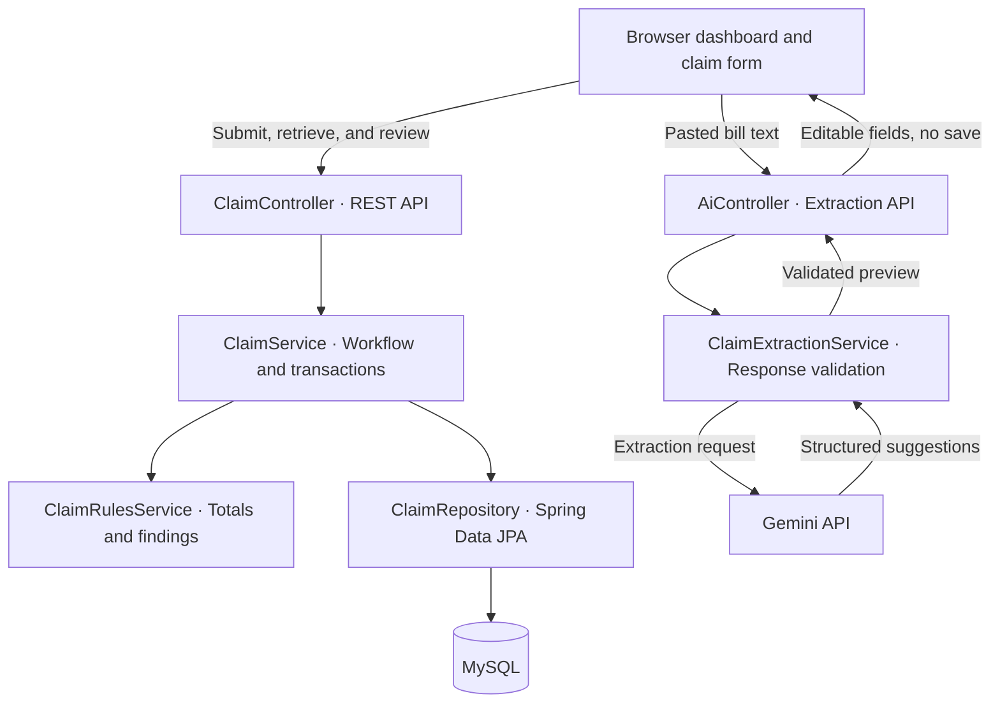
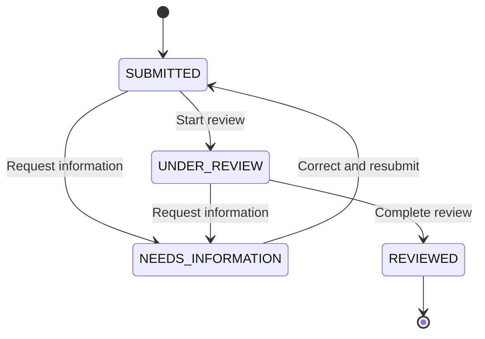

# ClaimCheck — AI-Assisted Healthcare Claim Review

A Spring Boot application for submitting healthcare reimbursement claims, validating bill details, tracking review workflows, and extracting structured claim information from bill text using the Gemini API. Includes a browser dashboard backed by MySQL and REST APIs.

## Problem Statement

Reimbursement requests can contain incomplete invoice details, inconsistent amounts, duplicate submissions, or incorrect service dates. Reviewing these requests requires both validation of the bill and a clear record of requests for information, corrections, and status changes.

ClaimCheck models this process with deterministic Java validation, a controlled claim lifecycle, and optional AI-assisted data entry. Users review extracted values before submitting them; the backend calculates totals and applies the validation rules.

> Educational prototype using synthetic data only. Business rules, including the 30-day submission deadline, are fictional. `REVIEWED` means internal review is complete; it is not an insurance approval or payment decision.

## Features

- Create claims with patient, provider, invoice, service date, and itemized bill details.
- Calculate line-item and claim totals using Java `BigDecimal` with two decimal places.
- Flag missing information, amount mismatches, future service dates, and late submissions.
- Reject duplicate claims for the same patient, provider, and invoice number.
- Enforce valid transitions between submission, review, information requests, and completion.
- Correct and resubmit claims that need additional information, recalculating their findings.
- Record status transitions with previous status, new status, notes, and timestamps.
- Protect status updates and resubmissions using JPA optimistic locking and client-supplied versions.
- Extract claim fields from pasted bill text with Gemini and present an editable preview before saving.
- Browse claims, filter by status, view findings, and track workflow counts through a browser dashboard.
- Return structured JSON errors for validation failures, conflicts, missing records, and AI-service errors.

## Tech Stack

| Layer | Technologies |
| --- | --- |
| Backend | Java 17, Spring Boot 3.3.5, Spring Web |
| Persistence | Spring Data JPA, Hibernate, MySQL |
| Validation | Jakarta Bean Validation, Java `BigDecimal` |
| AI integration | Gemini API, Java HTTP Client, Jackson |
| Frontend | HTML, CSS, vanilla JavaScript, Fetch API |
| Build | Maven |

The frontend is served directly by Spring Boot. Node.js and npm are not required.

## Architecture



The browser calls REST controllers, which delegate to transactional services. Services apply workflow and validation rules, then persist claims through Spring Data JPA. AI extraction uses a separate service that returns a preview without saving a claim.

| Component | Responsibility |
| --- | --- |
| `ClaimController` | Claim creation, retrieval, filtering, status changes, resubmission, and history |
| `ClaimService` | Transactions, duplicate checks, version checks, and lifecycle enforcement |
| `ClaimRulesService` | Monetary totals and rule-based findings |
| `ClaimRepository` | Claim persistence and lookup |
| `AiController` / `ClaimExtractionService` | Gemini requests, response validation, and extraction previews |
| Static frontend | Dashboard, editable claim forms, review controls, and history display |

## Claim Lifecycle



- Requesting information requires a reviewer note.
- Returning to `SUBMITTED` is allowed only through the resubmission endpoint.
- `REVIEWED` is a final state in this implementation.
- Status changes and resubmissions require the current claim `version`; stale updates return HTTP `409`.
- Findings and workflow status are separate. A claim can be marked reviewed while retaining validation findings. The dashboard's **Needs attention** count tracks `NEEDS_INFORMATION` claims.

## Validation Rules

| Finding | Condition |
| --- | --- |
| `MISSING_INFORMATION` | Invoice number, service date, claimed amount, or line items are missing |
| `AMOUNT_MISMATCH` | The claimed amount differs from the sum of the supplied line items |
| `FUTURE_SERVICE_DATE` | The service date is after the current date |
| `LATE_SUBMISSION` | The original submission date is more than 30 days after the service date |

Patient and provider names are required. Optional missing information produces findings instead of rejecting the claim. Supplied amounts must be positive and have at most two decimal places. Line-item quantities must be between 1 and 1,000; requests support at most 100 items.

Duplicate checks compare patient, provider, and invoice number without case sensitivity. A composite database unique constraint also protects this combination. Claims without an invoice number skip the invoice-based duplicate check.

## AI Extraction

1. Paste synthetic bill text into **Extract bill with AI**.
2. The backend sends it to Gemini and validates the returned field types and values.
3. Suggestions appear in an editable claim form. The extraction prompt instructs Gemini to leave absent values as `null` rather than inventing them.
4. Review the suggestions and explicitly submit the form.
5. Java calculates totals and evaluates findings before the claim is saved.

AI extraction does not save claims, change statuses, or decide whether a claim should be approved. The API key is read on the server and is not sent to the browser. Missing configuration, timeouts, rate limits, and invalid responses produce errors rather than fabricated previews. Manual claim creation works without an AI key.

## Run Locally

### Requirements

- JDK 17
- Maven 3.9+
- MySQL 8 running locally
- A Gemini API key for optional AI extraction

### 1. Create the database

Run the following as a MySQL administrator. Replace the example password with your own local password.

```sql
CREATE DATABASE claimcheck CHARACTER SET utf8mb4 COLLATE utf8mb4_unicode_ci;
CREATE USER 'claimcheck_user'@'localhost' IDENTIFIED BY 'replace_with_your_local_password';
GRANT ALL PRIVILEGES ON claimcheck.* TO 'claimcheck_user'@'localhost';
```

If the database and user already exist, reuse them. Hibernate creates or updates tables through `spring.jpa.hibernate.ddl-auto=update`.

### 2. Configure the environment and start the application

Open a terminal in the project directory containing `pom.xml`.

**Windows PowerShell**

```powershell
$env:DB_USERNAME = "claimcheck_user"
$env:DB_PASSWORD = "replace_with_your_local_password"
# Optional: required only for AI extraction
$env:GEMINI_API_KEY = "replace_with_your_api_key"
mvn spring-boot:run
```

**Linux / macOS**

```bash
export DB_USERNAME="claimcheck_user"
export DB_PASSWORD="replace_with_your_local_password"
# Optional: required only for AI extraction
export GEMINI_API_KEY="replace_with_your_api_key"
mvn spring-boot:run
```

These example values are placeholders. No `.env` file is required; this application reads process environment variables and does not include a dotenv loader.

Open [http://localhost:8080](http://localhost:8080).

### Configuration

| Variable | Purpose |
| --- | --- |
| `DB_PASSWORD` | Required database password |
| `DB_USERNAME` | Database username; defaults to `claimcheck_user` |
| `DB_URL` | Optional JDBC URL override; defaults to the local `claimcheck` database on port 3306 |
| `GEMINI_API_KEY` | Required only for AI extraction |
| `GEMINI_MODEL` | Optional model override; the checked-in configuration uses `gemini-3.5-flash-lite` |
| `GEMINI_BASE_URL` | Optional Gemini service base URL override |

Model availability depends on the API account. Set `GEMINI_MODEL` to a model available to your account if needed. The configured AI request timeout is 30 seconds.

## API Overview

| Method | Endpoint | Purpose |
| --- | --- | --- |
| POST | `/api/claims` | Create a claim |
| GET | `/api/claims` | List claims; optionally filter with `?status=SUBMITTED` |
| GET | `/api/claims/{id}` | Get claim details, amounts, and findings |
| PATCH | `/api/claims/{id}/status` | Change review status using the current version |
| PUT | `/api/claims/{id}/resubmission` | Correct and resubmit a claim needing information |
| GET | `/api/claims/{id}/history` | Retrieve status history |
| POST | `/api/ai/extract-claim` | Extract an unsaved preview from bill text |

### Example: create a claim

The following commands use Bash syntax. Replace the example service date with a recent date when testing date-dependent rules.

```bash
curl -X POST http://localhost:8080/api/claims \
  -H "Content-Type: application/json" \
  -d '{
    "patientName": "Demo Patient",
    "providerName": "Demo Clinic",
    "invoiceNumber": "DEMO-1001",
    "serviceDate": "2026-10-15",
    "claimedAmount": 500.00,
    "lineItems": [
      {"description": "Consultation", "quantity": 2, "unitPrice": 150.00},
      {"description": "Lab test", "quantity": 1, "unitPrice": 100.00}
    ]
  }'
```

The calculated total is **400.00**, so the response includes `AMOUNT_MISMATCH`. Date-related findings depend on when the request is submitted. Repeating the same patient, provider, and invoice combination returns `409`.

### Example: begin review

Use the ID and current version returned by the API. This example assumes claim `1` is still `SUBMITTED` at version `0`.

```bash
curl -X PATCH http://localhost:8080/api/claims/1/status \
  -H "Content-Type: application/json" \
  -d '{"status":"UNDER_REVIEW","note":"Review started","version":0}'
```

Use the latest returned version for every subsequent update.

### Example: extract an AI preview

```bash
curl -X POST http://localhost:8080/api/ai/extract-claim \
  -H "Content-Type: application/json" \
  -d '{"billText":"SYNTHETIC TEST BILL\nPatient: Demo Patient\nProvider: Demo Clinic\nInvoice: DEMO-1002\nService date: 2026-10-15\nConsultation: 2 x $150.00\nLab test: 1 x $100.00\nTotal billed: $500.00"}'
```

Review the extracted fields, then submit them through the claim form or `POST /api/claims`.

## Database Overview

| Table | Stores |
| --- | --- |
| `claims` | Patient/provider details, invoice, dates, amounts, workflow status, and version |
| `claim_line_items` | Descriptions, quantities, and unit prices linked to a claim |
| `claim_flags` | Validation findings associated with each claim |
| `claim_status_history` | Previous/new statuses, notes, and transition timestamps |

## Error Handling

Errors share a JSON structure containing `timestamp`, `status`, `error`, `message`, and `details`.

| HTTP status | Examples |
| --- | --- |
| 400 | Invalid input, malformed JSON, or missing information-request note |
| 404 | Claim not found |
| 409 | Duplicate claim, invalid transition, or stale version |
| 502 | Invalid or unusable AI response |
| 503 | AI not configured, unavailable, or rate limited |

## Verification

Manual browser checks have covered:

- Extracting a complete synthetic bill into an editable preview.
- Preserving absent invoice, service date, and claimed amount fields.
- Saving an incomplete claim with a missing-information finding.
- Calculating totals independently of the bill's stated amount and flagging mismatches.
- Rejecting a repeated patient/provider/invoice combination.
- Updating review statuses and the dashboard counters.

This repository does not currently include an automated test suite. Resubmission, date boundaries, concurrent-update conflicts, and AI failure paths are useful next targets for automated tests.

## Scope and Limitations

- Intended for local demonstrations with synthetic data. Authentication and role-based authorization are not implemented.
- Extraction accepts pasted text; PDF/image upload and OCR are not implemented.
- Claims are reviewed internally; there is no insurer integration, payment processing, or notification delivery.
- AI suggestions can be incorrect and require human review. Pasted bill text is sent to the Gemini API.
- Schema management uses Hibernate `ddl-auto=update`; versioned database migrations are not included.
- Claim listing is not paginated.

## Credentials and Repository Hygiene

Database credentials and the Gemini key are supplied through environment variables. Keep actual values out of source files, documentation, screenshots, and commits. The included `.gitignore` excludes environment files, build output, logs, and common IDE files.
